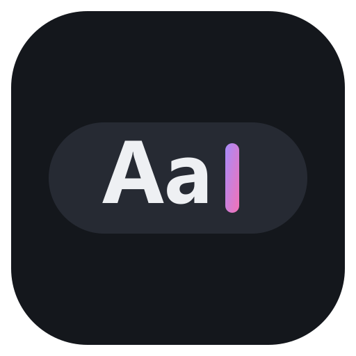

<p align="center">
  
</p>

<h1 align="center">Custom Dock Text</h1>

<p align="center">
  Put your own text on the PowerToys Command Palette Dock: a reminder, a goal, a quote, anything.
</p>

<p align="center">
  
</p>

## Features

- **Any text up to 80 characters**, shown in full. The Dock normally cuts labels off after a few words, so this one asks for room to fit the whole text.
- **Optional icon** from 43 Windows Fluent icons, in the same style as the Dock's built-in widgets. Pick it from a list that shows each icon.
- **Edit in a click**: click the text on the Dock, or run **Set Dock text** from Command Palette.
- **Stays put**: the text is saved and comes back after restarts.
- **Private and offline**: no network access, no accounts, no telemetry.

## Install

Requires Windows 10/11 and [PowerToys](https://github.com/microsoft/PowerToys) 0.102 or later with Command Palette and its Dock enabled.

**[Get it from the Microsoft Store](https://apps.microsoft.com/detail/9P4DH4N33GLQ)**.

Then right-click the Dock, choose **Edit**, add the **Custom Dock Text** band, and click it to set your text.

<details>
<summary>Install from GitHub instead</summary>

In PowerShell:

```powershell
irm https://raw.githubusercontent.com/Arihant25/custom-dock-text/main/install.ps1 | iex
```

The script downloads the latest release for your CPU (x64 or ARM64), trusts its signing certificate (a single UAC prompt, because this build is self-signed) and installs it.

Install one or the other, not both: the Store and GitHub builds are separate apps.

To install by hand:

1. Download `CustomDockText_<version>_<x64|arm64>.msix` and `CustomDockText.cer` from [Releases](https://github.com/Arihant25/custom-dock-text/releases/latest).
2. In an elevated PowerShell: `Import-Certificate -FilePath CustomDockText.cer -CertStoreLocation Cert:\LocalMachine\TrustedPeople`
3. Double-click the `.msix`, or run `Add-AppxPackage <file>.msix`.

</details>

## Usage

| To | Do this |
|---|---|
| Change the text | Click it on the Dock (or run **Set Dock text**), choose **Edit text**, type, **Save** |
| Change the icon | Same page, pick one under **Icon**. The current one is tagged **Current**; type to search |
| Hide the icon | Pick **No icon** |
| Clear the text | Save an empty text. A small pencil stays on the Dock so you can click it later |
| Move it | Right-click the Dock, **Edit**, and drag it |

## Good to know

- Full-width text needs PowerToys 0.102 or later. Older versions cut the label off.
- The text and icon are saved in the app's own data folder and removed when you uninstall it.

## Building

Requires the .NET 10 SDK. No Windows SDK install is needed; `pack.ps1` uses the build tools from NuGet.

```powershell
./pack.ps1 -SelfSign -Install            # build, sign with a local dev cert, install (x64)
./pack.ps1 -Version 1.0.0.0 -Platform arm64 -SelfSign
./pack.ps1 -Version 1.0.0.0 -Store       # unsigned Store upload (x64 + ARM64 bundle)
```

## License

[MIT](LICENSE). Not affiliated with Microsoft.
